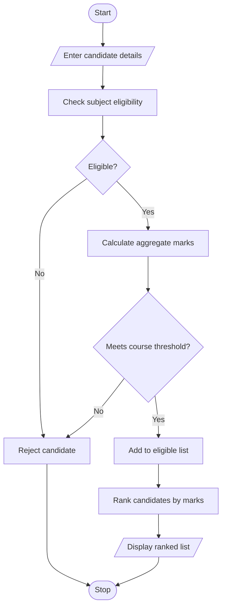

## 1. PROBLEM STATEMENT
To develop a University Admission Decision Engine that evaluates candidates based on subject eligibility, aggregate marks, and course-specific minimum marks. It selects eligible candidates and ranks them according to their marks.
## 2. ALGORITHM
1. Start.
2. Enter candidate details and marks.
3. Check subject eligibility.
4. Calculate aggregate marks.
5. Check course-specific threshold.
6. Select eligible candidates.
7. Rank candidates based on aggregate marks.
8. Display the ranked list.
9. Stop.
## 3. FLOWCHART 

## 5. SAMPLE INPUT
Enter number of candidates: 3
Name: Ravi
Enter 3 subject marks: 80 75 85
Name: Sita
Enter 3 subject marks: 90 85 95
Name: Raju
Enter 3 subject marks: 30 45 50
## 6. SAMPLE OUTPUT
Admission Rank List:
Sita 90.0
Ravi 80.0
