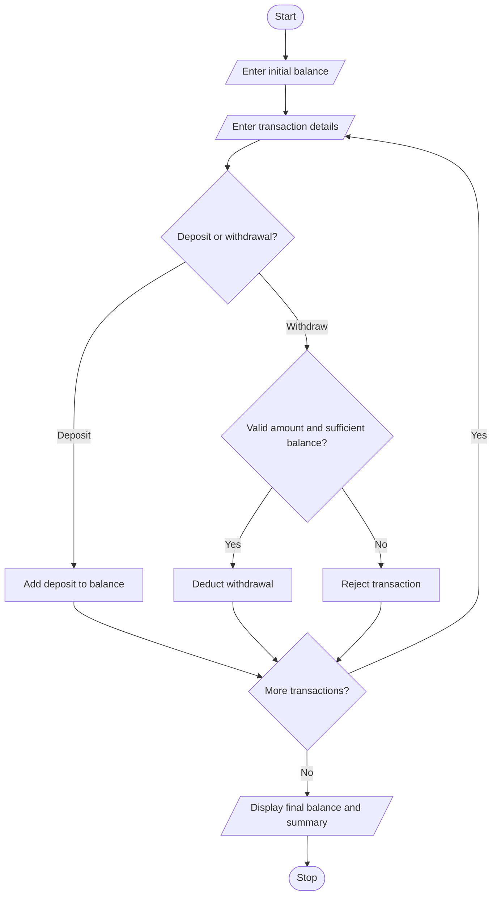

## 1. PROBLEM STATEMENT
To simulate ATM transactions by processing deposits and withdrawals, maintaining the account balance, enforcing withdrawal limits, rejecting invalid transactions, and displaying a transaction summary.
## 2. ALGORITHM
1. Start.
2. Enter the initial balance.
3. Enter the number of transactions.
4. Select deposit or withdrawal.
5. Accept valid transactions and reject invalid ones.
6. Enforce the withdrawal limit and available balance.
7. Display the final balance and transaction summary.
8. Stop.
## 3. FLOWCHART 

## 5. SAMPLE INPUT
Initial balance: 20000
Number of transactions: 4
Enter D/W and amount: D 5000
Enter D/W and amount: W 3000
Enter D/W and amount: W 15000
Enter D/W and amount: W 2000
## 6. SAMPLE OUTPUT
Balance: 20000.0 Deposits: 1 Withdrawals: 2 Rejected: 1
Explanation:
Initial balance = ₹20,000
Deposit = ₹5,000
First withdrawal = ₹3,000
Second withdrawal = ₹15,000 (rejected because it exceeds the limit)
Third withdrawal = ₹2,000
Final balance = ₹20,000
