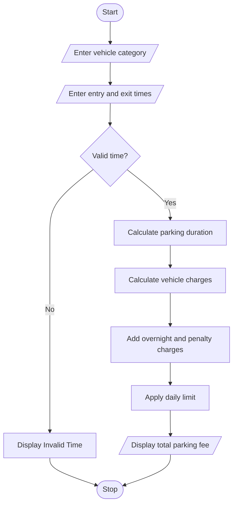

## 1. PROBLEM STATEMENT
To calculate parking fees based on vehicle category, entry and exit times, overnight parking, daily limits, and penalty charges while validating time inputs.
## 2. ALGORITHM
1. Start.
2. Enter vehicle category.
3. Enter entry and exit times.
4. Validate the time inputs.
5. Calculate parking duration.
6. Calculate charges based on vehicle category.
7. Add overnight and penalty charges if applicable.
8. Apply the daily parking limit.
9. Display the total parking fee.
10. Stop.
## 3. FLOWCHART 

## 5. SAMPLE INPUT
Vehicle (B/C): C
Entry and exit hours (0-23): 8 18
## 6. SAMPLE OUTPUT
Parking hours: 10 Total fee: Rs. 400
Explanation:
Vehicle: Car
Parking duration: 10 hours
Rate: ₹40 per hour
Total charge: 10 × 40 = ₹400
No overnight or penalty charge.
