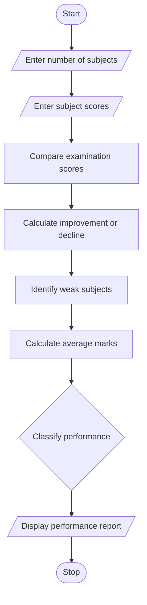

## 1. PROBLEM STATEMENT
To analyze student performance by comparing scores across multiple examinations, calculating improvements and declines, identifying weak subjects, and classifying students based on their marks.
## 2. ALGORITHM
1. Start.
2. Enter the number of subjects.
3. Enter subject names and examination scores.
4. Compare previous and current scores.
5. Calculate improvements and declines.
6. Identify consistently weak subjects.
7. Calculate average marks.
8. Classify student performance.
9. Display the performance report.
10. Stop.
## 3. FLOWCHART

## 5. SAMPLE INPUT
Number of subjects: 3
Subject: Maths
Previous and current marks: 60 80
Subject: Physics
Previous and current marks: 50 35
Subject: Chemistry
Previous and current marks: 30 35
## 6. SAMPLE OUTPUT
Maths Improvement/Decline: 20
Physics Improvement/Decline: -15
Chemistry Improvement/Decline: 5 Weak
Average: 50.0
Result: Needs Improvement
Explanation:
Maths: Improved by 20 marks.
Physics: Declined by 15 marks.
Chemistry: Consistently weak (below 40 in both exams).
Average marks = 50.
Classification = Needs Improvement.
