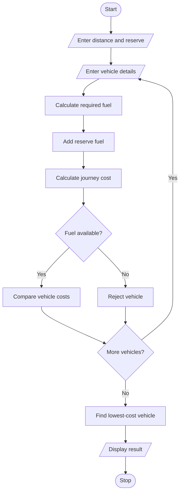

## 1. PROBLEM STATEMENT
To calculate fuel requirements and journey costs for multiple vehicles using distance, mileage, fuel price, and reserve requirements, and identify the lowest-cost feasible vehicle.
## 2. ALGORITHM
1. Start.
2. Enter the journey distance.
3. Enter the number of vehicles.
4. Enter mileage and fuel price for each vehicle.
5. Calculate required fuel.
6. Add reserve fuel.
7. Calculate total journey cost.
8. Compare vehicle costs.
9. Display the lowest-cost feasible vehicle.
10. Stop.
## 3. FLOWCHART

## 5. SAMPLE INPUT
Journey distance: 200
Number of vehicles: 2
Reserve fuel: 2
Vehicle name: Bike
Mileage, fuel price, available fuel: 40 100 10
Vehicle name: Car
Mileage, fuel price, available fuel: 20 100 15
## 6. SAMPLE OUTPUT
Bike Fuel: 7.0 Cost: 700.0
Car Fuel: 12.0 Cost: 1200.0
Lowest cost: Bike 700.0

