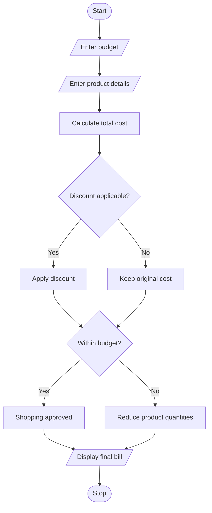

## 1. PROBLEM STATEMENT
To calculate the total cost of a shopping basket containing multiple products and quantities, apply discounts, compare the total with a fixed budget, and identify which product quantities must be reduced to stay within the budget.
## 2. ALGORITHM
1. Start.
2. Enter the shopping budget.
3. Enter the number of products.
4. Enter product name, price, and quantity.
5. Calculate the total shopping cost.
6. Apply discount if applicable.
7. Compare total cost with the budget.
8. Identify products whose quantities must be reduced.
9. Display the final shopping cost.
10. Stop.
## 3. FLOWCHART (MERMAID)

## 5. SAMPLE INPUT
Enter budget: 1000
Number of products: 3
Name, price, quantity: Pen 20 5
Name, price, quantity: Book 100 5
Name, price, quantity: Bag 600 1
## 6. SAMPLE OUTPUT
Final bill: 900.0
Remaining products:
[['Pen', 20.0, 5], ['Book', 100.0, 5]]
